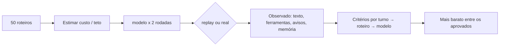

# Lili Eval Bench — bancada de avaliação para um atendente de IA no WhatsApp

**Resumo.** Bancada de roteiros com critérios verificáveis para decidir se um modelo de linguagem pode atender
famílias de uma escola no WhatsApp: chama as ferramentas certas, lembra o que já foi dito, não promete o que não fez e
cabe no orçamento. Extraída de um atendente em produção (Lili, Lili Labs) e reescrita para rodar localmente, com
dados sintéticos.

```bash
npm ci && npm run bench   # modo replay: sem chave de API, sem custo
npm test                  # testes dos critérios, do custo, dos módulos e da sanitização
```

## O problema
Trocar de modelo ou de prompt num agente com ferramentas quebra coisas que um "parece bom" não pega. Em 19/10/2026 o
atendente de uma escola de demonstração repetiu perguntas, confirmou visita sem agendar e prometeu chamar a equipe
sem avisar ninguém. → [`docs/postmortem-2026-10-19.md`](docs/postmortem-2026-10-19.md)

## Arquitetura
Diagramas em [`docs/arquitetura.md`](docs/arquitetura.md); decisões em [`docs/adr/`](docs/adr/).



| Pasta | O que tem |
|---|---|
| `bench/` | critérios (`avaliar.mjs`), custo e teto (`custo.mjs`), orquestrador (`executar.mjs`), adaptadores, roteiros |
| `atendente/` | funções puras do atendente: portão, buffer, prompt, memória longa, conferência da resposta, pedido de humano, aviso, blocos, contingência; `prompt-base.exemplo.txt` |
| `n8n/` | 4 workflows do atendimento multi-escola, sanitizados |
| `scripts/` | `sanitizar-n8n.mjs` (sanitização + verificação), `gerar-gravacoes.mjs` (replay sintético) |
| `fixtures/` | escola fictícia e gravações sintéticas do replay |
| `exemplos/sql/` | tabelas e funções de exemplo (trava contra visita duplicada, memória), escritas do zero |
| `relatorios/exemplo/` | relatório de exemplo, ilustrativo |

## O fluxo em n8n
`n8n/` traz os 4 workflows do atendimento multi-escola, sanitizados por `scripts/sanitizar-n8n.mjs` (sem credenciais,
ids nem URLs reais; tudo vira variável de ambiente ou marcador). Webhook → pausa se a equipe respondeu → buffer Redis
→ transcrição de áudio → memória → agente com ferramentas de visita → conferência da resposta → handoff com aviso
único → saída em blocos. Explicação de cada bloco: [`docs/n8n.md`](docs/n8n.md).

## Como avaliamos
50 roteiros (38 críticos), 2 rodadas por modelo, critérios por turno (ferramentas, memória, aviso à equipe, texto,
blocos). Reprova com 1 crítico em falha ou mais de 3 avisos. Escolhe o mais barato entre os aprovados; o gpt-4o roda
como régua e nunca é escolhido. Teto de custo de US$ 20 com estimativa antes de gastar.
→ [`docs/criterios.md`](docs/criterios.md)

## Resultados
- **O que a bancada pegou:** vazamento de chamada de ferramenta no roteiro R13 com o gpt-6-luna (o texto que iria
  para a família trazia a chamada da ferramenta). Com esse dado, o responsável decidiu como tratar o defeito (a
  conferência da resposta passou a limpar o vazamento e a bancada passou a reprovar quando isso acontece); hoje o
  modelo em uso é o gpt-6-luna. Data da rodada: a confirmar.
- 9 roteiros nascidos do post-mortem de 19/10 (R31–R39, segundo as notas do projeto; a confirmar).
- Teto de custo por execução da bancada: US$ 20 (o script recusa acima disso sem confirmação).

(Resultados técnicos da bancada. Não são resultados de negócio de nenhuma escola.)

### Relatório de exemplo (ilustrativo, modo replay)
Gravações sintéticas com defeitos plantados de propósito; os nomes `candidato-A`/`candidato-B` são fictícios e o custo
é simulado por uma tabela de exemplo. Completo em [`relatorios/exemplo/relatorio.md`](relatorios/exemplo/relatorio.md).

| Modelo | Críticos em falha | Avisos | Pendentes | Custo (simulado) | Resultado |
|---|---|---|---|---|---|
| gpt-4o | 0 | 1 | 0 | US$ 14.62 | régua |
| candidato-A | 0 | 2 | 0 | US$ 2.34 | passa |
| candidato-B | 2 (R13, R33) | 3 | 0 | US$ 0.59 | reprova: há roteiro crítico reprovado |

Escolhido: candidato-A (menor custo entre os que passaram). O candidato-B é mais barato, mas vaza chamada de
ferramenta (R13) e promete chamar a equipe sem avisar (R33).

## Como rodar
```bash
npm ci && npm run bench                 # replay, sem chave, sem custo; grava relatorios/ultimo.md
npm run bench -- --so 13,33             # só alguns roteiros
npm test                                # testes (node:test, sem dependências)
npm run sanitizar:verificar             # confere os JSON do n8n
# opcional, modo real (gasta dinheiro; respeita o teto):
OPENAI_API_KEY=... npm run bench -- --real --modelos gpt-4.1-mini
```
Node 20 ou mais novo. Nenhuma dependência de produção.

## Aprendizados
- Regras que importam saem do prompt e vão para o fluxo (memória, handoff).
- Conferir a resposta depois do agente é mais barato que confiar no modelo.
- Uma bancada barata e repetível vale mais que uma avaliação grande e rara.
- Todo incidente vira roteiro.

## Limites honestos
- O replay usa respostas sintéticas; não prova comportamento em produção. Ele demonstra os critérios e o relatório.
- Critérios por texto (`contem`) são frágeis a sinônimos; por isso um item pode aceitar várias formas.
- O fluxo original roda em n8n; os JSON publicados são sanitizados (comentários dos nós Code removidos) e precisam de
  credenciais e de um banco próprios. A bancada local usa uma versão simplificada.
- O modo real é um atendente local mínimo (prompt de exemplo + ferramentas declaradas): não reproduz buffer, memória
  gravada nem aviso real, e não foi exercitado contra a API neste repositório.
- O prompt de produção e o esquema real do banco não estão aqui; `atendente/prompt-base.exemplo.txt` e
  `exemplos/sql/` são versões curtas escritas do zero.
- Classificador de mensagens e busca com reranker existiram em versões anteriores do fluxo e não estão no fluxo publicado.
- Sem métrica de negócio (conversão, matrículas): não está medida e não é afirmada.
- Código escrito com agentes de código (Claude Code, Cursor, Grok Bot) sob direção do autor, que definiu o problema,
  as regras e as decisões, e revisou o resultado.

## Autor
Ricardo — projeto e operação da Lili (Lili Labs). Contato: a definir.

Licença MIT.
