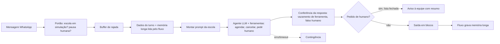
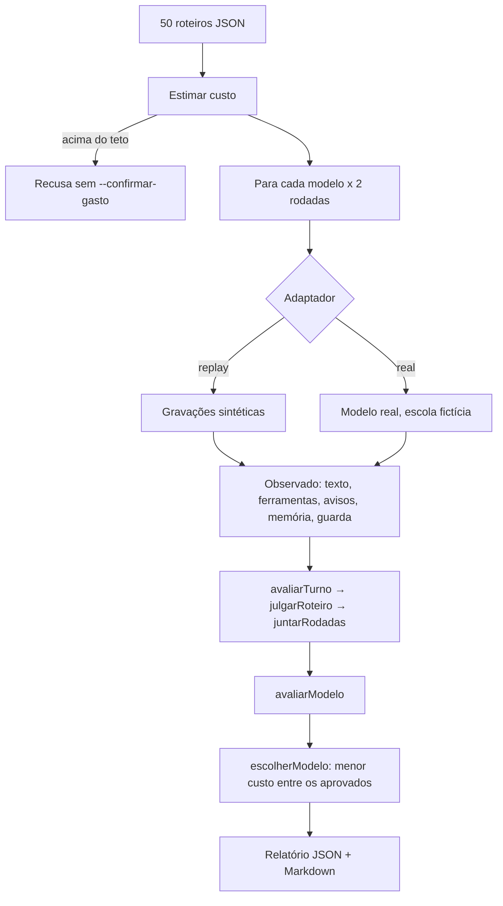

# Arquitetura

## O atendente (como funciona no produto, simplificado)

Os módulos em `atendente/` são as funções puras desses blocos (portão, buffer, montagem do prompt, memória longa,
conferência da resposta, pedido de humano, aviso à equipe, blocos e contingência). No produto elas são coladas em nós
Code do n8n; aqui rodam direto no Node.

## A bancada

| Peça | Arquivo |
|---|---|
| Critérios | `bench/avaliar.mjs` |
| Custo e teto | `bench/custo.mjs` |
| Orquestrador | `bench/executar.mjs` |
| Adaptadores | `bench/adaptadores/` (contrato em `interface.md`) |
| Roteiros | `bench/roteiros/roteiros.json` |
| Escola fictícia | `fixtures/escola-ficticia.json` |
| Gravações (replay) | `fixtures/gravacoes/<modelo>/<id>.json`, geradas por `scripts/gerar-gravacoes.mjs` |

Decisões: `docs/adr/`.
