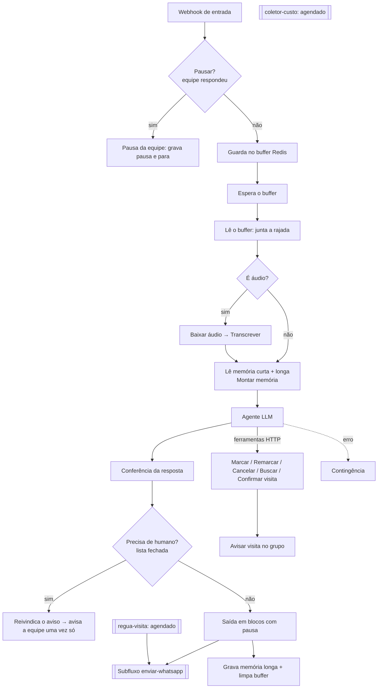

# O fluxo em n8n

`n8n/` traz os 4 workflows do atendimento multi-escola, sanitizados por `scripts/sanitizar-n8n.mjs`:
`lili-escolas.json` (atendimento), `enviar-whatsapp.json` (saída), `regua-visita.json` (lembretes de visita) e
`coletor-custo.json` (custo de IA). Não há credenciais, ids, URLs nem tokens reais: tudo virou variável de ambiente
(`n8n/.env.exemplo`) ou marcador (`CREDENCIAL_*`, `__WF_ENVIAR_WHATSAPP__`, `example.invalid`). Comentários dentro dos
nós Code foram removidos pela sanitização; a explicação está nos módulos de `atendente/` e aqui.

## Blocos
- **Buffer de rajada.** Famílias mandam 3 ou 4 mensagens seguidas. O fluxo guarda cada uma numa lista no Redis, espera alguns segundos e responde uma vez à rajada inteira, em vez de responder cada pedaço.
- **Pausa quando a equipe responde.** Se uma pessoa da equipe escreveu na conversa, o fluxo pausa o atendente. A decisão é do fluxo, não do prompt: o modelo não precisa "lembrar" de ficar quieto.
- **Transcrição de áudio.** Áudio é baixado pelo subfluxo de envio e transcrito antes do agente; sem transcrição, a resposta não vale (critério da bancada).
- **Memória curta e longa.** A memória longa (dados que a família já deu) é lida pelo fluxo antes do agente e gravada pelo fluxo depois do turno. Antes dependia de o modelo chamar uma ferramenta, e ele às vezes não chamava (ver `postmortem-2026-10-19.md` e ADR 0003).
- **Ferramentas de visita.** São chamadas HTTP para funções no banco, que têm trava: não duplicam visita, recusam data passada e horário fora da janela (ver `exemplos/sql/`).
- **Conferência da resposta.** Depois do agente, funções determinísticas conferem o texto: limpam vazamento de chamada de ferramenta, trocam "vou chamar a equipe" sem chamada real por uma chamada real, e conferem a visita antes de confirmar (ADR 0004).
- **Handoff com aviso único.** O pedido de humano segue uma lista fechada de gatilhos. O aviso à equipe é "reivindicado" antes de enviar, para sair uma vez só por conversa aberta (ADR 0005).
- **Saída em blocos.** A resposta é dividida em até 3 mensagens curtas, com pausa entre elas.
- **Contingência.** Se algo falha (banco, Redis, modelo), a família recebe uma mensagem segura, uma vez só.
- **Régua de visita e coletor de custo.** Workflows agendados: um manda lembretes de visita pelo subfluxo de envio; o outro consolida o custo de IA por escola.

Reranker e classificador de mensagens existem em versões anteriores do fluxo, não no fluxo multi-escola publicado.

Como importar num n8n local: `n8n/README.md`.
